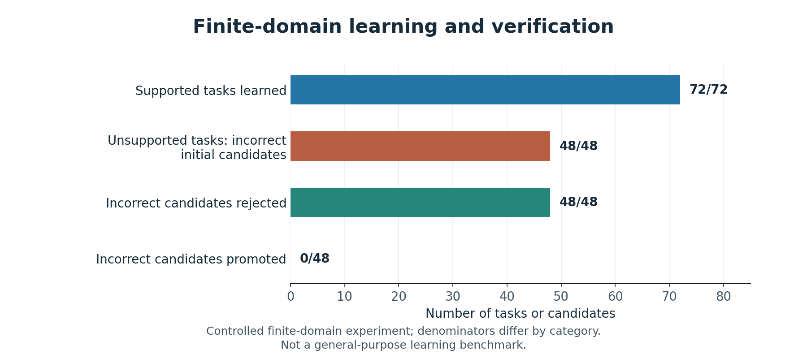
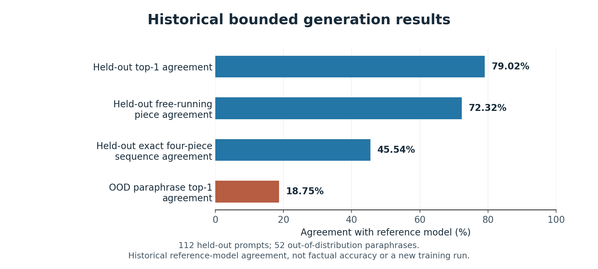
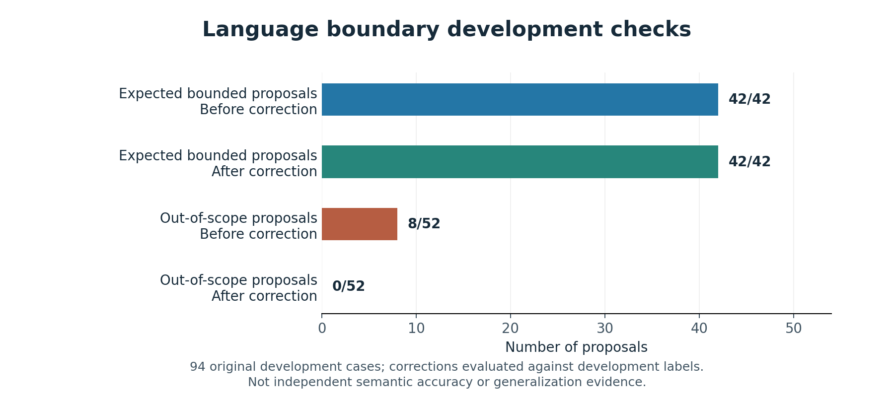

# Independent AI Research — Progress and Results

**Deepak Kainthal | Research in progress | November 2026**

I am exploring whether AI systems can keep learning and improving while retaining earlier knowledge, handling multi-step tasks more reliably, and using computing resources more carefully.

This repository is a public record of selected research updates. It is **not a software release** or a claim that a complete general-purpose AI system has been built.

## What I am studying

- Reliability when a task has several requirements and all of them must be satisfied.
- Learning new information without damaging earlier knowledge.
- Memory accuracy and maintenance during repeated operation.
- Reducing unnecessary computation without sacrificing correct results.

## Selected results

These numbers come from saved results of controlled experiments, mostly with synthetic tasks. The tests were **not independently rerun** for this public release.

| Study | Recorded result | Test scope |
|---|---|---|
| Complete-task success | **6.8327% → 47.4030%** | Matched synthetic comparison, **25 million queries per condition** |
| Knowledge accuracy | **91.242% → 99.003%** | Different conditions in a **120,000-event** generated-learning study |
| Harmful knowledge updates | **2,163 → 59** | Same learning study, comparison of those two conditions |
| Memory maintenance work | **At least 62.651% less simulated work** | Five separate runs of **one million generated events** |

The results have different test designs and should **not** be combined into a single overall AI performance score.

### Figures

**Complete-task success** — exact whole-task correctness, not the accuracy of individual steps.

**Knowledge accuracy** — three conditions in one controlled learning study.

## Research progress — Part II (27 November 2026)

### From controlled experiments to executable intelligence

Following the initial research, I investigated how AI systems can acquire new capabilities, recognise incorrect learning, verify proposed knowledge, and preserve reliability as the work moves toward executable software. Further experiments also explored mathematical verification, bounded generation, multilingual instruction understanding, and computational reliability.

### Selected results — Part II

| Study | Recorded result | Test scope |
|---|---|---|
| Finite-domain learning | **72/72** supported tasks learned | Controlled finite-domain tasks |
| Incorrect learning detection | **48/48** incorrect candidates rejected; **0/48** promoted | Unsupported tasks in the same controlled study; all initially produced incorrect candidates |
| Conditional statistical evaluation | **1,200/1,200** intervals covered the known probability | Synthetic trials under stated statistical assumptions |
| Real-model decision evaluation | **36/40** decisions correct | Recorded finite-domain decisions regraded against a separate mathematical reference |
| Bounded native generation | **16/16** and **12/12** recorded outputs reproduced; **164/164** inputs produced bounded output | October reconstruction of historical learned behavior; not a new training benchmark |
| Multilingual decision consistency | **12/12** cases completed; all 12 showed at least one disagreement | English, Hindi and Hinglish development study; 60 model requests |
| Language boundary development | **8/8** identified boundary breaches addressed; **42/42** expected bounded proposals preserved | Development checks, not independent semantic accuracy |
| Structural reliability | **12,288/12,288** reference comparison matches | Exhaustive finite structural comparison without the operational search cap |
| Software qualification | **922** workspace library unit tests passed | 13 November bounded software qualification; additional integration and code-quality checks reported |

These results come from different studies and cannot be combined into a single AI performance score. They include recorded experiments, reproduction evidence, development diagnostics, and software qualification results.

### Figures — Part II

**Learning and verification** — successful acquisition in the supported domain and rejection of incorrect candidates outside it.

**Bounded native generation** — historical agreement with a reference model, revisited through October output reproduction. Performance on out-of-distribution paraphrases remained limited.

**Language boundary checks** — observed development corrections and preservation of previously supported proposals.

The figures above are redrawn from recorded experimental values for this repository. They are not additional experimental runs.

### Scientific observations and remaining questions

- Learning a behavior and establishing its correctness are separate challenges. Successful examples alone may not reveal incorrect learning elsewhere.
- Reproducing bounded generative behavior does not establish general language competence or factual accuracy.
- Multilingual experiments revealed decision inconsistency, even when all cases completed. Independent semantic assessment remains necessary.
- Software reliability and computational work reduction are being investigated separately from measured hardware performance.

The results remain limited to their respective experimental conditions. General-purpose AI capability, independent external validation, measured hardware efficiency, and production readiness have not been established by these findings.

**Full research continuation:** [Read Part II — From Controlled Experiments to Executable Intelligence (PDF)](research-paper-part-ii-nov-2026.pdf)

## Short research overview

[Read the two-page overview (PDF)](research-introduction-nov-2026.pdf).

For precise context, see [RESULTS.md](RESULTS.md). For the public research timeline, see [UPDATES.md](UPDATES.md).

## What the results do not establish

- They do **not** prove that a finished general-purpose AI model exists.
- They do **not** establish performance on public, real-world AI benchmarks.
- The work estimates in some experiments do **not** measure electrical energy or GPU efficiency on physical hardware.
- Independent replication is not yet available from this public record, and some experiments found meaningful failures or trade-offs.

## What I plan to share

I will post progress when there is a meaningful result, a new limitation, or a question worth discussing. I am interested in scientific feedback on **the research questions and evaluation methods**, including ways to test reliability more rigorously.

Detailed implementation and unpublished methods are not part of this public repository.

**First public introduction:** [LinkedIn research update](https://www.linkedin.com/feed/update/urn:li:activity:7530185731298811904/)

## Research Publications

### Part I — Research Introduction
Initial experimental findings in continuous learning, reasoning reliability, knowledge preservation, and computational efficiency.

[Read Part I (PDF)](research-introduction-nov-2026.pdf)

### Part II — From Controlled Experiments to Executable Intelligence
Published: 27 November 2026

Further experimental findings in autonomous learning, mathematical verification, reasoning, language understanding, and system reliability, along with progress toward executable intelligence.

[Read Part II (PDF)](research-paper-part-ii-nov-2026.pdf)

Both documents are part of my ongoing independent AI research.

— Deepak Kainthal
