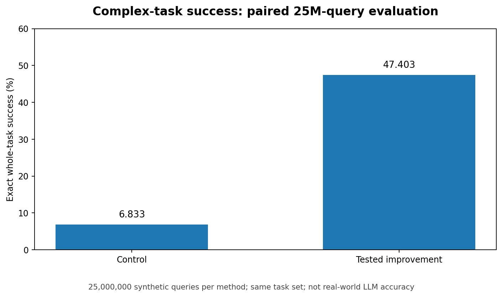
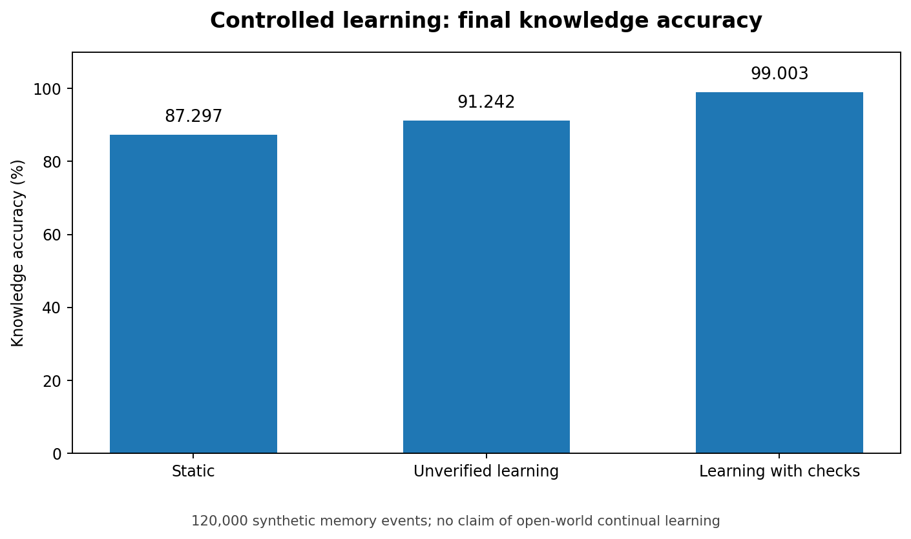

# Independent AI Research — Progress and Results

**Deepak Kainthal | Research in progress | November 2026**

I am exploring whether AI systems can keep learning and improving while retaining earlier knowledge, handling multi-step tasks more reliably, and using computing resources more carefully.

This repository is a public record of selected research updates. It is **not a software release** or a claim that a complete general-purpose AI system has been built.

## What I am studying

- Reliability when a task has several requirements and all of them must be satisfied.
- Learning new information without damaging earlier knowledge.
- Memory accuracy and maintenance during repeated operation.
- Reducing unnecessary computation without sacrificing correct results.

## Selected results

These numbers come from saved results of controlled experiments, mostly with synthetic tasks. The tests were **not independently rerun** for this public release.

| Study | Recorded result | Test scope |
|---|---|---|
| Complete-task success | **6.8327% → 47.4030%** | Matched synthetic comparison, **25 million queries per condition** |
| Knowledge accuracy | **91.242% → 99.003%** | Different conditions in a **120,000-event** generated-learning study |
| Harmful knowledge updates | **2,163 → 59** | Same learning study, comparison of those two conditions |
| Memory maintenance work | **At least 62.651% less simulated work** | Five separate runs of **one million generated events** |

The results have different test designs and should **not** be combined into a single overall AI performance score.

### Figures

**Complete-task success** — exact whole-task correctness, not the accuracy of individual steps.

**Knowledge accuracy** — three conditions in one controlled learning study.

## Short research overview

[Read the two-page overview (PDF)](research-introduction-nov-2026.pdf).

For precise context, see [RESULTS.md](RESULTS.md). For the public research timeline, see [UPDATES.md](UPDATES.md).

## What the results do not establish

- They do **not** prove that a finished general-purpose AI model exists.
- They do **not** establish performance on public, real-world AI benchmarks.
- The work estimates in some experiments do **not** measure electrical energy or GPU efficiency on physical hardware.
- Independent replication is not yet available from this public record, and some experiments found meaningful failures or trade-offs.

## What I plan to share

I will post progress when there is a meaningful result, a new limitation, or a question worth discussing. I am interested in scientific feedback on **the research questions and evaluation methods**, including ways to test reliability more rigorously.

Detailed implementation and unpublished methods are not part of this public repository.

**First public introduction:** [LinkedIn research update](https://www.linkedin.com/feed/update/urn:li:activity:7530185731298811904/)

— Deepak Kainthal
