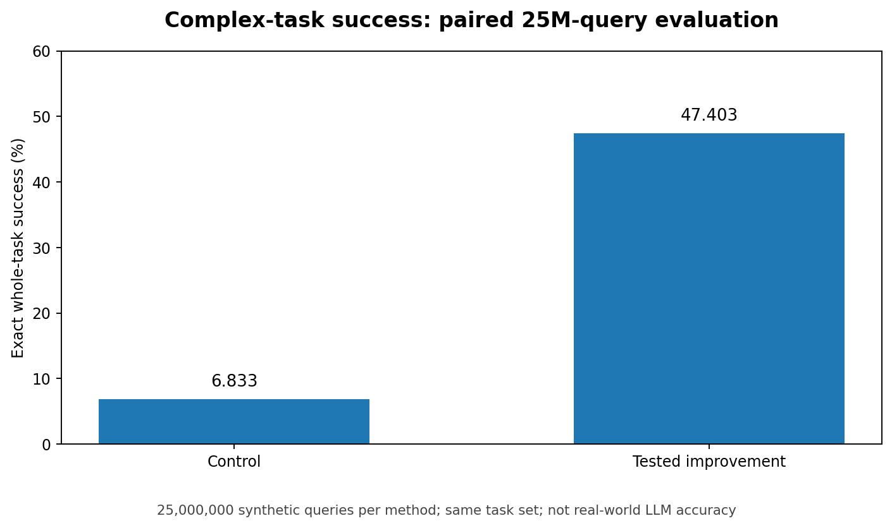
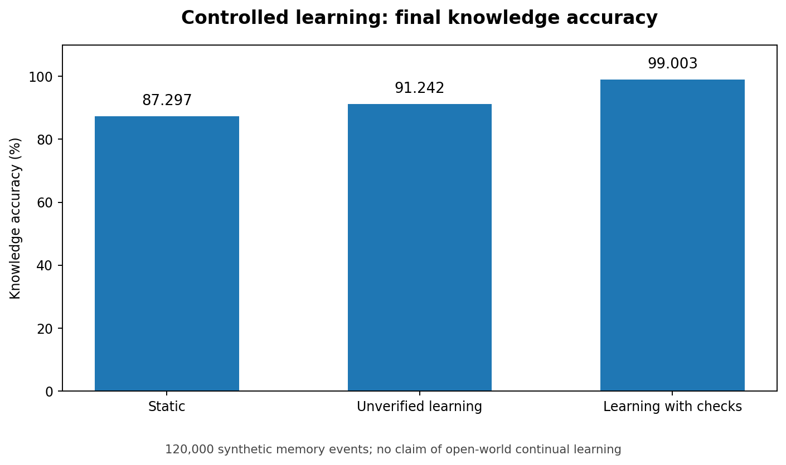

# Selected Research Findings — November 2026

This page provides context for the summary numbers. The outcomes are **recorded findings within specific controlled tests**, not third-party replication or proof of general AI capabilities.

## 1. Exact complete-task success

- **Control:** 6.8327%.
- **Tested condition:** 47.4030%.
- **Evaluation:** matched, controlled synthetic task set; 25,000,000 queries per method.
- **Metric:** percentage of entire queries for which all required parts were correct.
- **Interpretation:** the tested condition had higher exact complete-task success on this task set.
- **Boundary:** the dataset is synthetic; this result is not a public benchmark score or proof of similar accuracy on open-ended tasks.

## 2. Learning and knowledge accuracy

In a controlled study of **120,000 generated learning events**:

| Condition | Final knowledge accuracy |
|---|---:|
| Static comparison | 87.297% |
| Learning without the same checks | 91.242% |
| Learning with checks | **99.003%** |

In that study, the two learning conditions recorded **2,163** and **59** harmful knowledge updates, respectively. The static condition is **not** a comparable denominator for that update-reduction comparison because it does not perform learning updates.

**Boundary:** this is a generated-event experiment, not a demonstration of general continual learning in unrestricted real-world use.

## 3. Memory maintenance

Across **five separate simulated runs of one million events each**, the recorded minimum reduction in modeled maintenance work was **62.651%** relative to the study's comparison condition.

**Boundary:** this is a work estimate inside the controlled simulation, **not** a measurement of real GPU power, electricity, physical memory usage, or disk throughput.

## Interpretation and evidence availability

These are selected aggregate values from archived research-test records. The public overview was prepared from those saved records; the underlying experiments were not independently rerun for this release.

Public material here includes charts and a short explanation. Detailed test-generation logic, private datasets, and implementation are not provided. This limits outside replication at the current stage. I intend to keep reporting the evaluated scope, positive findings, and important failures as the work develops.

---

## Part II — Further Research Findings

Published: 27 November 2026

| Research area | Recorded result |
|---|---|
| Finite-domain learning | 72/72 supported tasks successfully learned |
| Learning verification | 48/48 incorrect candidates rejected |
| Conditional statistical evaluation | 1,200/1,200 intervals covered the known probability under stated assumptions |
| Native generation reproduction | 16/16 and 12/12 recorded output matches in two reported checks |
| Structural reliability | 12,288/12,288 reference comparison matches |
| Software qualification | 922 workspace library unit tests passed |

Further multilingual experiments revealed challenges in language understanding and decision consistency.

These results are specific to their respective experimental conditions. They do not establish general-purpose AI capability, independent experimental validation, or measured hardware efficiency.

[Read the complete Part II research paper (PDF)](research-paper-part-ii-nov-2026.pdf)
